# Guodelist for Android

The Android client for Guodelist — the same tasks,
the same backend, in a native Kotlin + Jetpack Compose app.

The desktop app is a Tauri window with a warm, paper-like surface. This is the same product on a
phone: one calm list, quick capture in plain language, a month view that is worth looking at, and a
sync that never makes you think about syncing.

| Tasks (Today) | Calendar | Week view |
| --- | --- | --- |
| 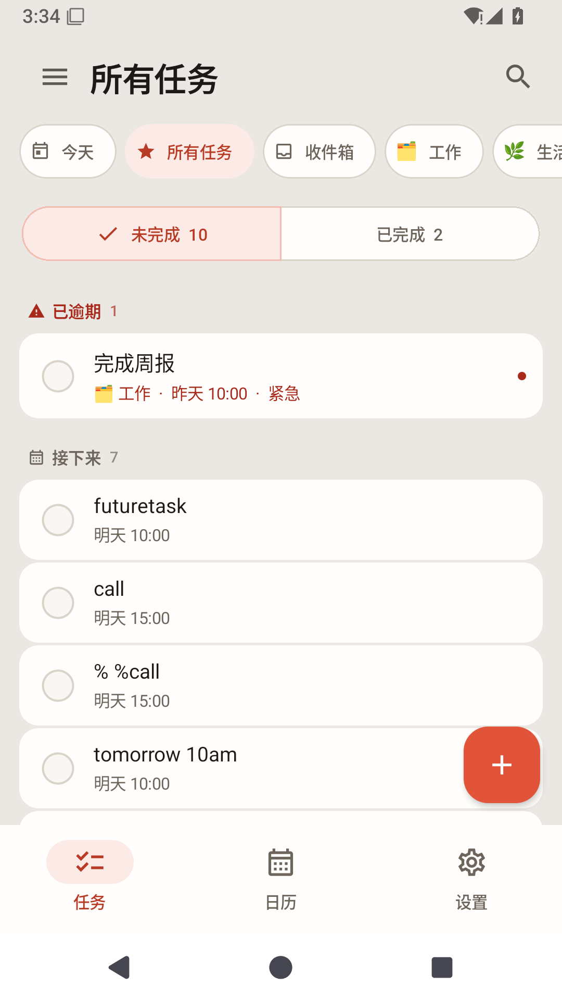 | 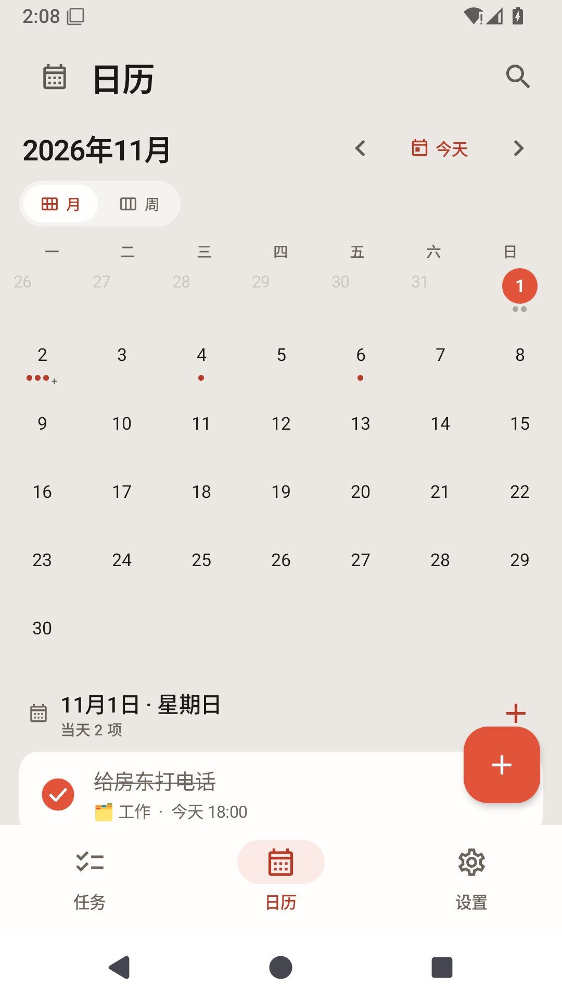 | 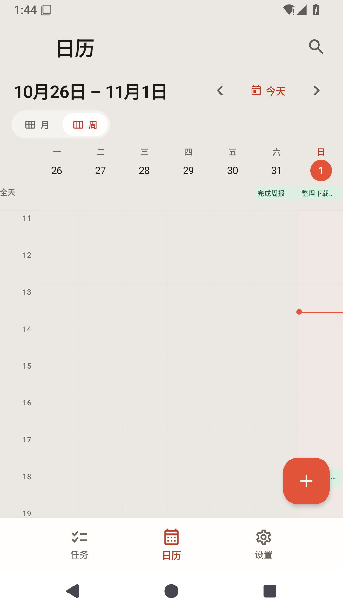 |
| **Search history** | **Widget lists** | **Settings** |
| 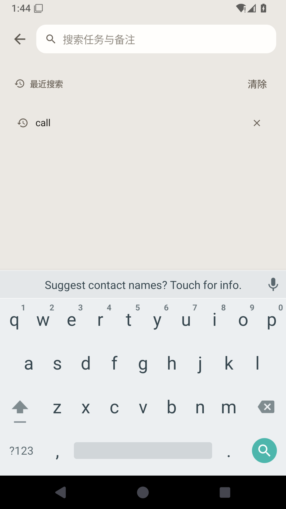 | 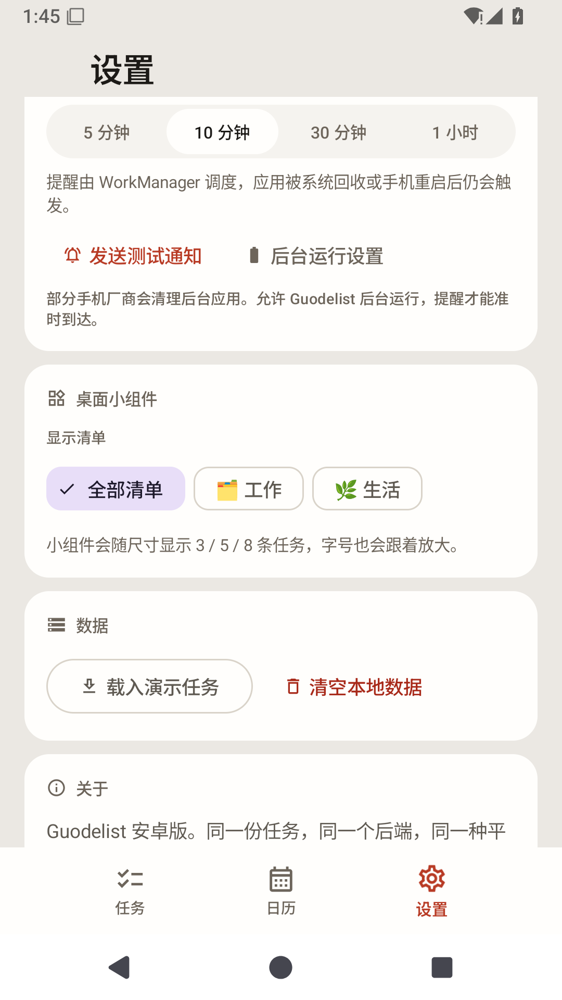 | 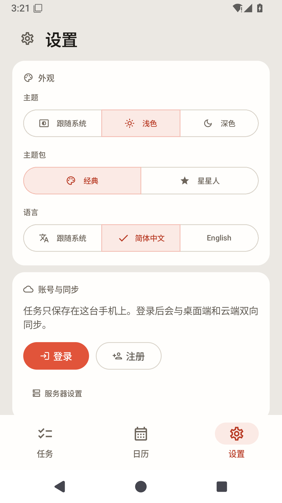 |
| **Quick capture** | **Reminders** | **Home screen widget** |
| 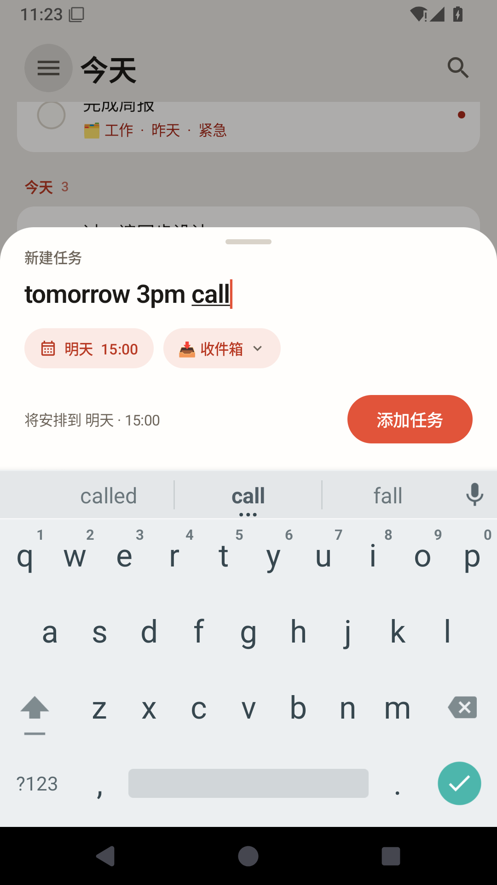 | 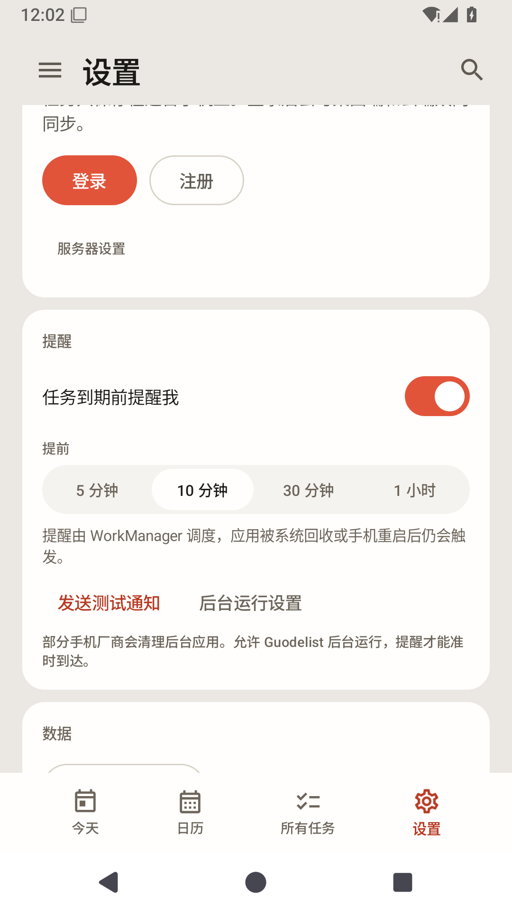 | 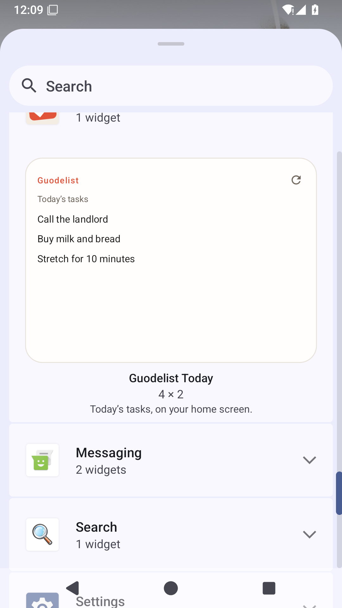 |
| **Dark, same palette** | **Task detail** | **Notification** |
| 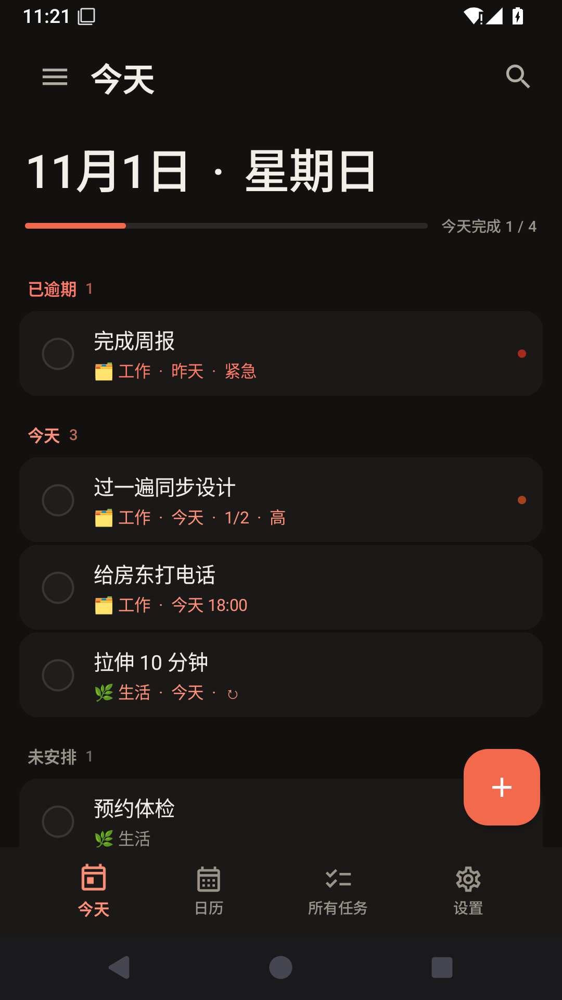 | 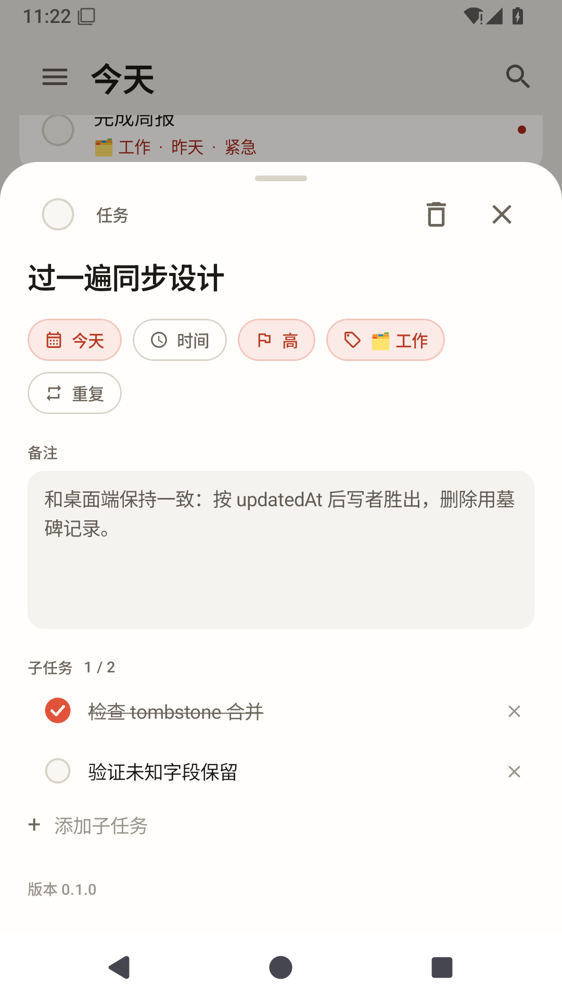 | 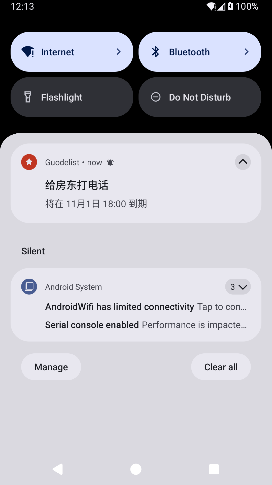 |
| **Full-screen editor** | **Date picker** | **Delete with undo** |
| 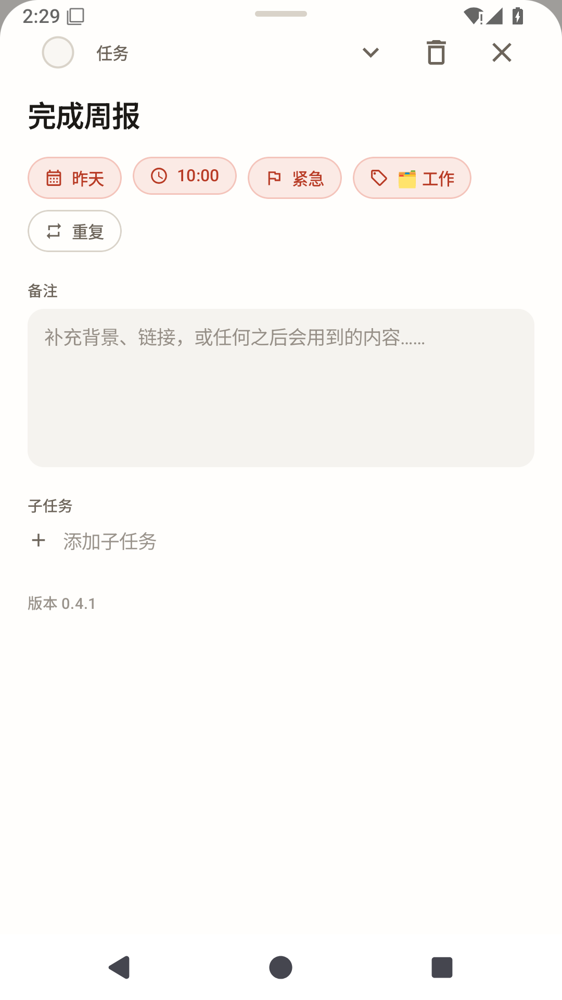 | 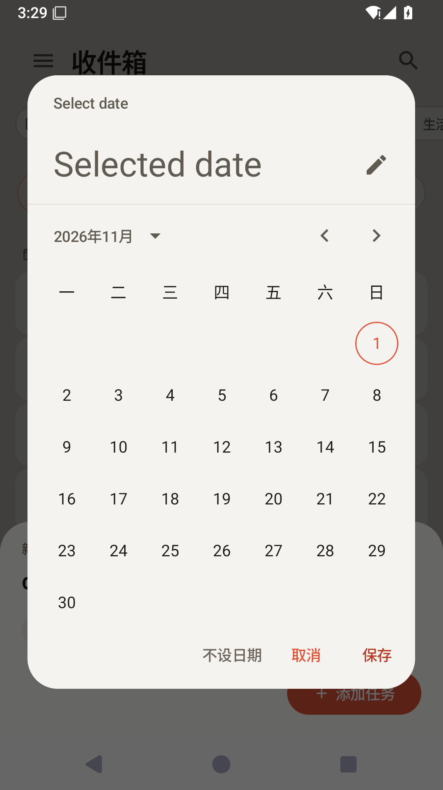 | 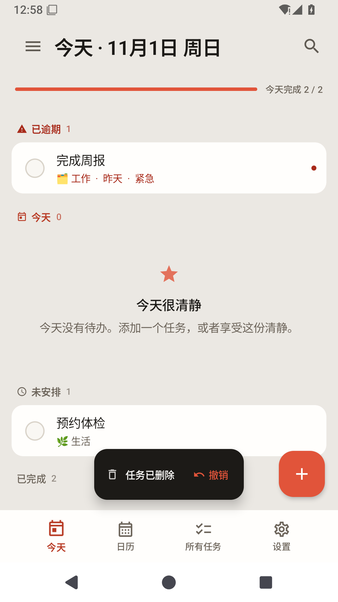 |
| **In-app update** | | |
| 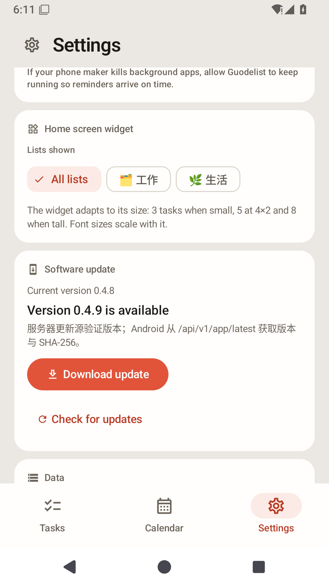 | | |

## What it does

- **One Tasks tab, many lists** — Today, All, Inbox and your own lists are chips under the title;
  tap a chip to switch lists. Swipe left or right to move between the three top-level pages (Tasks,
  Calendar, Settings); tapping a bottom tab jumps instantly without a click animation.
- **Today** — a single-line date title, what is due, what slipped, what you got done; a progress bar
  that fills as you work. Completed tasks are listed at the bottom of every list, without a
  show/hide toggle or a separate Completed page.
- **New tasks stay visible** — if you create a future-dated task while on Today, the app switches to
  the list that contains it (Inbox or the chosen list), so the new row is immediately on screen.
  A late sync response cannot remove a task created in the last two minutes.
- **Quick capture** — type `明天 10 点 给房东打电话` or `tomorrow 3pm call the landlord`; the date and
  time are read out of the sentence and previewed before you save. The date chip is also editable:
  tap it to open the native date dialog, pick a date, clear it, or keep the parsed one.
- **Search with history** — search titles, notes and lists; the last eight searches appear when the
  field is empty, each with its own delete button plus a one-tap clear.
- **Native controls** — theme / palette / language / reminder lead / month-week all use Material 3
  segmented buttons and filter chips, tinted with the Guodelist palette rather than the default
  purple. Taps give a light haptic tick and the system click sound.
- **Task detail** — opens at half height so the list stays in view; pull the header or tap the
  chevron to reach a true full-screen editor. The time chip opens a native Material time dial with
  Save / Cancel / Clear time, and choosing a time without a date assigns today.
- **Calendar** — a month grid with task dots and the selected day's agenda, plus a desktop-style week
  grid: seven day columns, hour lines, an all-day row, pastel event blocks that split when they
  overlap, today's column tinted, and a live current-time line. Switch 月/周 in place. The drawer is
  Tasks-only; Calendar is just the calendar.
- **HyperOS widgets** — three home-screen cards designed to Xiaomi's widget guidance: Today
  (2×2 / 4×2 / 4×4, 1 / 3 / 6 tasks + completion progress), Upcoming (4×2, next dates) and Quick add
  (2×2, opens the capture sheet). 24dp corners, 16dp safe area, MiSans/system type hierarchy, dark
  mode, per-task deep links. Settings chooses which lists the data widgets show. See
  [docs/WIDGETS.md](docs/WIDGETS.md).
- **Switchable app icon** — Settings → App icon offers Default (system adaptive mask), Circle,
  Square and Irregular. Switching uses Android activity-alias components, so the launcher icon updates
  without reinstalling; the choice survives updates. See [docs/ICONS.md](docs/ICONS.md).
- **Reminders** — a notification before a timed task is due (5 / 10 / 30 / 60 minutes ahead, 09:00 for
  all-day tasks). WorkManager owns the schedule, so reminders survive the app being closed and the
  phone rebooting; Settings also links to the battery-optimisation screen for OEMs that kill apps.
- **Xiaomi HyperOS** — on Xiaomi devices reminders carry a best-effort `miui.focus.param` Super
  Island payload (title, due text, AOD line). Rendering still requires the app to be registered and
  whitelisted on the HyperOS developer platform; without approval the system ignores the extra and
  shows the normal notification.
- **Rear screen (妙享背屏)** — there is no public third-party API. The screen is display 1 and can
  only be addressed with shell-level access (Shizuku/root + `am display move-stack`), so this release
  does not ship rear-screen mirroring; see the notes below.
- **Smooth appearance changes** — switching palette / light-dark cross-fades the whole palette over
  260 ms, and switching language updates every string in place without recreating the Activity.
- **In-app update** — Settings → Software update reads the latest GitHub Release
  (`TankNee/guodelist-android`), downloads its APK, checks the optional `.sha256`, and opens
  Android's installer. Set `GUODELIST_UPDATE_SOURCE=api` to use a self-hosted release API instead.
- **Offline first** — everything is stored in a private JSON document; edits sync two seconds after
  you stop typing, every minute in the foreground, and when you tap *Sync now*. A task created just
  before a sync response arrives is kept for two minutes, so a stale response cannot make it vanish.
- **Two languages, fully translated** — English and 简体中文, switchable at runtime (follow system
  too).
- **Two palettes** — Classic (warm grey + vermilion) and Starry (cream + orange), each in light and
  dark.
- **An icon that belongs** — a warm cream adaptive icon with a tilted vermilion note and check, plus a
  monochrome layer for Android 13 themed icons.

## Same backend, same records

`POST /api/v1/sync` is the one endpoint the desktop app uses, and this app speaks it verbatim:

- login / register / me at `/api/v1/auth/*` and `/api/v1/me`;
- the payload is every list and task the phone has, plus tombstones for deletions;
- the server merges last-write-wins by `updatedAt` and echoes the merged document back;
- unknown fields (`attachments`, future additions) are kept as raw JSON, so a round trip through
  the phone never destroys data the desktop wrote.

The default server is `https://api.example.com`; set your own for local builds with environment
variables (or a git-ignored `.env` / `local.properties`):

```bash
GUODELIST_SERVER=https://api.your-server.example \
GUODELIST_GITHUB_REPO=TankNee/guodelist-android \
./gradlew :app:assembleDebug
```

Release builds intentionally strip the server address to `https://api.example.com`; a private
distribution can opt in with `-PGUODELIST_ALLOW_RELEASE_CONFIG=true`.

Update checks use GitHub Releases by default (`TankNee/guodelist-android`). Override with
`GUODELIST_GITHUB_REPO=your-account/guodelist-android`, or use a self-hosted release server with
`GUODELIST_UPDATE_SOURCE=api`.

## Motion

The motion language follows the way openGym feels — physical, quick, interruptible — rather than a
generic Material default. See [docs/MOTION.md](docs/MOTION.md) for the tokens and the rules:

- springs for anything a finger touches, cubic-beziers only for content that appears on its own;
- 120 ms tap acknowledgement, 200–320 ms settle, no entrance animations on first paint;
- the checkmark is drawn, not toggled: the stroke grows from 28% to 73% in 150 ms;
- swipes complete or delete at 36% travel and settle with a spring;
- Tasks, Calendar and Settings are the only three pager pages; a task list is a chip, not a page.
  Tab taps call `scrollToPage` (no animated click), and the bar is the standard Material 3
  `NavigationBar` rather than a hand-rolled animated tab.
- the detail sheet opens at half height, fills the screen when expanded, and springs to full when
  you pull the header or tap the chevron.

## Xiaomi notes

**Super Island.** The client-side contract is a normal notification plus a JSON string in
`miui.focus.param`; this app attaches a minimal `param_v2` payload (ticker, AOD title, big/small
island text and focus `baseInfo`) to reminders on Xiaomi devices. Xiaomi requires the app to be
registered on the [HyperOS developer platform](https://dev.mi.com/xiaomihyperos/documentation/detail?pId=2132)
and whitelisted for the island scenario before the system will render it; the payload is ignored
otherwise. See the [island development guide](https://dev.mi.com/xiaomihyperos/documentation/detail?pId=2131)
for the template fields.

**Rear screen.** Xiaomi 17 Pro / Pro Max "妙享背屏" is exposed as display 1, not through a public
third-party API. Projects that mirror content there (for example
[Folia](https://github.com/wmqc97/folia-android)) obtain shell access through Shizuku or root and run
`am display move-stack`; without that, an app cannot place a window on the rear panel. Adding that
would mean shipping a Shizuku dependency and a privileged setup flow, which is deliberately out of
scope for this build.

## Build

Requirements: JDK 17, Android SDK 35 (`platforms;android-35`, `build-tools;35.0.0`), Gradle 8.9.

```bash
./gradlew :app:assembleRelease     # signed release APK (needs keystore.properties)
./gradlew :app:testDebugUnitTest   # parser, recurrence and merge tests
./gradlew :app:assembleDebug       # local development only
```

For release builds create `keystore.properties` in the repository root (git-ignored):

```properties
storeFile=C:/path/to/guodelist-release.jks
storePassword=...
keyAlias=guodelist
keyPassword=...
```

Keep that keystore and password backed up: every future in-app update must be signed with the same
key, otherwise Android refuses to install it over the existing app.

The app is `cn.neeto.guodelist`, minSdk 26, targetSdk 35.

## Download

`v0.4.21` is available as a **release-signed**, sideloadable APK from this repository's
GitHub Releases page (or your own release server).
`adb install -r guodelist-android-0.4.21-release.apk`, or open the APK on the phone.

Updates are hosted by the API server configured at build time and discovered in Settings → Software update.
The release process is documented in [docs/RELEASING.md](docs/RELEASING.md).

The 0.4.5 release uses a new signing key, so one-time uninstall of any older debug build is required.
After that, release-to-release in-app updates work normally.

## Project layout

```
app/src/main/java/cn/neeto/guodelist/
  core/model/       raw JSON records + typed accessors (unknown fields survive sync)
  core/data/        pure task/list operations, atomic JSON store, tombstones
  core/net/         OkHttp client for the v1 sync API, SyncManager
  core/notifications/ WorkManager reminders, channels, scheduler
  core/update/      server update check, SHA-256-verified APK download, installer hand-off
  core/util/        dates, natural-language parser, recurrence
  core/settings/    SharedPreferences-backed settings + auth token
  core/i18n/        in-app language override
  widget/           home-screen RemoteViews provider + today snapshot
  ui/theme/         GuoColors palettes, typography, composition locals
  ui/motion/        GuoMotion tokens and press-scale modifier
  ui/components/    task rows, swipe rows, top bar, drawer, feed
  ui/screens/       today/list feed, calendar, detail sheet, quick add, search, settings
  ui/AppViewModel.kt, ui/AppRoot.kt, MainActivity.kt
```

## Tests

The pure parts are covered without an emulator:

- `NaturalDateParserTest` — Chinese and English capture, "下周一" across a week boundary, no guessing.
- `TaskOpsTest` — task/list CRUD, permanent tombstones, list-delete cascade, last-write-wins merge,
  reorder, subtasks, restore, and unknown-field preservation.

```bash
./gradlew testDebugUnitTest
./gradlew jacocoTestCoverageVerification
./gradlew jacocoTestReport
```

JaCoCo enforces at least 80% line coverage for `TaskOps` (currently ~97%); `check` depends on the gate.

## Not yet

The phone is deliberately a smaller surface than the desktop, but these gaps are real:

- Attachments and task comments are **preserved** through sync but not shown or editable here.
- Drag-to-reorder, groups and the command palette are desktop-only.
- Reminders are WorkManager jobs, so Doze may delay them by a few minutes; there is deliberately no
  foreground service keeping the process alive.
- Updates come from the API server configured at build time; the phone needs network access to that server.

## License

MIT. Built with Jetpack Compose; the visual language and motion feel are inspired by
[openGym](https://github.com/DuarteSantos8/openGym) and the desktop Guodelist design notes. No
openGym code is copied.

## Jev task suggestions

AI is off by default. Set the remote AI API base in Settings first; then, when signed in, Quick Add has a **Jev suggest** button. It sends only the task title and local date to the Guodelist API, which asks Jev for one likely date and one list. The result is applied to the date/list chips before you press Add.

The Jev key is server-side only:

```bash
export JEV_API_KEY='...'
export JEV_MODEL='jev-latest'          # optional
export JEV_ENDPOINT='https://api.typesafe.ai/v1/systemone'  # optional
```

Without `JEV_API_KEY` the API returns `AI_NOT_CONFIGURED`; the normal local natural-date parser keeps working.
